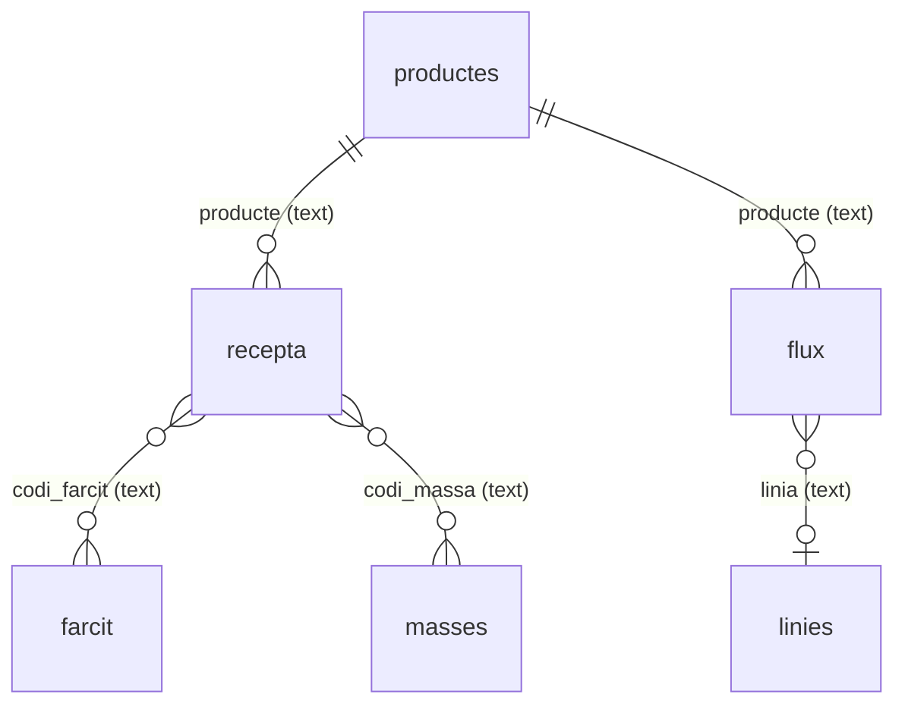

# Model de dades — productes i receptes

Referència de com es guarda la informació de producció i de com hi arriba. Descriu el que fa
el codi avui. Els problemes detectats són a [revisio-model-de-dades.md](revisio-model-de-dades.md).

Fonts: `supabase-schema.sql` (taules), `src/App.jsx` (prompts de la IA, resolució d'entitats,
desat) i `src/useDatabase.js` (escriptura a la BD).

---

## Visió general

| Taula | Pestanya | Una fila és… | Àmbit |
|---|---|---|---|
| `productes` | Productes | un producte | per producte |
| `recepta` | Recepta | una combinació producte + farcit + massa | per producte |
| `flux` | Flux | un pas de fabricació en un recurs | per producte |
| `farcit` | Farcit | una matèria primera dins d'un `R####` | catàleg compartit |
| `masses` | Masses | una matèria primera dins d'una massa `M####` | catàleg compartit |
| `linies` | Recursos | un recurs físic | catàleg compartit |
| `torns` | Torns | una persona i els seus torns | manual, fora d'aquest document |
| `gravacions` | (sense pestanya) | una descripció desada | per producte, només s'hi afegeix |

**Totes les relacions són per text.** La BD no té claus foranes, ni `UNIQUE`, ni `NOT NULL`, ni
`CHECK`: l'única clau de cada taula és l'`id` (uuid). Qui manté la coherència és el codi de l'app.

---

## Codis

| Format | Significat | On apareix |
|---|---|---|
| `########` | Codi de producte | `producte` |
| `R####` | Farcit | `codi_farcit` |
| `M####` | **Massa o matèria primera.** El format és ambigu: ho decideix el paper que fa a la frase | `codi_massa`, `codi_nom_mp`, `codi_intervinent` |
| `M####.1` | Subpas d'una matèria (neteja, subtasca) | només `flux.codi_intervinent` |
| Nom lliure | Matèria primera sense codi (`Ricotta`) | `codi_nom_mp` |

---

## Taules

Unitats implícites: pes en kg o g segons el nom de la columna, temps en minuts, merma en decimal
(`0.03` = 3 %). Cap d'aquestes convencions no està imposada per la BD.

### `productes`

| Columna | Tipus | Contingut |
|---|---|---|
| `producte` | text | Codi del producte. Actua com a identificador |
| `grup` | text | Nom comercial (`Crepes Salados 110gr`) |
| `unitats_per_palet`, `caixes_per_palet`, `unitats_per_caixa` | numeric | Empaquetat |
| `kg_massa_palet`, `kg_farcit_palet` | numeric | Kg per palet. Un sol valor encara que hi hagi diversos codis |
| `codi_massa`, `codi_farcit` | text | **Llista** de codis separats per comes (`M0002, M0007`) |
| `dies_permesos` | text | `Dc-Dj-Dv` o noms complets |
| `incompatible_amb` | text | Text lliure |
| `comentaris` | text | |
| `transcripcio` | text | Totes les gravacions del producte, una darrere l'altra. Oculta a la taula, es veu amb 📄 |
| `basat_en` | text | Codi del producte base si és una variant. La variant manté totes les seves files |

### `recepta`

Identitat a l'app: `producte` + `codi_farcit` + `codi_massa`.

| Columna | Tipus | Contingut |
|---|---|---|
| `producte` | text | Codi del producte |
| `codi_farcit` | text | Un sol `R####` |
| `grams_per_unitat_farcit`, `merma_farcit` | numeric | Grams per unitat final i merma del farcit |
| `codi_massa` | text | Una sola `M####` |
| `grams_per_unit_massa`, `merma_massa` | numeric | Grams per unitat final i merma de la massa |
| `kg_farcit_palet`, `kg_massa_palet` | numeric | Kg per palet d'aquest farcit i d'aquesta massa, si es dicten per separat |
| `comentaris` | text | |

### `farcit` i `masses`

Mateixa estructura, amb `codi_farcit` o `codi_massa` com a primera columna.
Identitat prevista: codi + `codi_nom_mp`.

| Columna | Tipus | Contingut |
|---|---|---|
| `codi_farcit` / `codi_massa` | text | Codi al qual pertany la matèria |
| `codi_nom_mp` | text | Codi `M####` **o** nom de la matèria primera |
| `kg_per_palet` | numeric | Kg d'aquesta matèria per palet de producte |
| `merma` | numeric | Merma d'aquesta matèria |

Una fila amb `codi_nom_mp` buit és un **codi pendent**: es crea perquè tot codi referenciat tingui
fila, i es marca amb ⚠️ fins que se'n registra la composició.

### `flux`

Identitat a l'app: `producte` + `dia` + `pas` + `linia`; si falta `pas`, `producte` + `dia` +
`codi_intervinent` + `linia`.

| Columna | Tipus | Contingut |
|---|---|---|
| `producte` | text | Codi del producte |
| `pas` | integer | Índex global i ordre del pas |
| `dia` | numeric | Dia del cicle de producció |
| `accio` | text | Què es fa en aquest pas |
| `codi_intervinent` | text | Matèria principal del pas, o null si és administratiu |
| `linia` | text | Recurs físic ocupat, o null. Les files antigues poden tenir-hi el nom de la tasca |
| `massa` | numeric | Kg que intervenen en el pas |
| `temps_per_kg` | text | Text lliure: `45 minuts / 150 kg`, `1400 unidades / hora` |
| `persones_necessaries` | numeric | |
| `perfils_de_persona` | text | Text lliure: `Cocinero / Directa` |
| `es_pot_parar` | text | `Sí` / `No` |
| `prerequisits` | text | Text lliure: `Finalitzar M2001` |
| `comentaris` | text | Límits tècnics i notes |

### `gravacions`

Totes les descripcions, tal com es van desar. La BD només permet llegir-ne i afegir-ne: no accepta
modificacions ni esborrats. El text de les variants comença per `[Duplicat de CODI]`.

| Columna | Tipus | Contingut |
|---|---|---|
| `producte` | text | Codi del producte |
| `text` | text | Descripció completa |

### `linies` (Recursos)

Identitat a l'app: `linia`, amb coincidència aproximada.

| Columna | Tipus | Contingut |
|---|---|---|
| `linia` | text | Nom del recurs |
| `tipus` | text | `màquina`, `olla`, `forn`… |
| `quantitat` | numeric | Unitats idèntiques i intercanviables. Per defecte 1 |
| `descripcio` | text | |
| `temps_preparacio`, `temps_neteja`, `temps_espera` | numeric | Minuts |
| `comentaris` | text | Capacitats i límits, en text lliure |

---

## Com hi arriben les dades

1. **Dictat o text** a la pestanya Productes.
2. **Tres crides a la IA**: producte, recepta, farcit i masses (Opus); flux (Sonnet); recursos nous
   (Sonnet). Cada crida retorna JSON amb les claus de les taules.
3. **Resolució d'entitats** (`resolveCanonicalNames`): compara el proposat amb la BD i marca cada
   fila com a `✦ Nou` o `↻ Actualitza`. Normalitza noms i crea els recursos que falten.
4. **Codis pendents** (`ensureCompositionStubs`): crea fila per als codis sense composició.
5. **Previsualització**: l'usuari pot editar o treure files.
6. **Confirmar** (`confirmAll`): valida les files, desa primer la descripció a `gravacions` i després
   taula per taula: productes → recepta → farcit → masses → linies → flux. No és una transacció: les
   files que fallen es queden a la previsualització.

### Com es comparen les files

| Taula | Comparació |
|---|---|
| `productes` | `producte` exacte |
| `recepta` | producte exacte i codis compatibles (un codi buit es pot completar) |
| `flux` | `producte` exacte, `dia`, `pas` i `linia` aproximada |
| `linies` | `linia` aproximada |
| `farcit`, `masses` | codi exacte i `codi_nom_mp` aproximat |

La comparació aproximada (`fuzzyMatch`) accepta plurals i fins a 2 caràcters de diferència, però els
números han de ser idèntics (`Màquina 1` i `Màquina 4` són diferents).
La normalització ignora majúscules, accents i espais repetits.

### Què fa cada acció

| Acció | Efecte |
|---|---|
| **Gravar** un producte existent | Només omple camps buits. Excepció: `codi_massa`, `codi_farcit` i `transcripcio` de `productes` acumulen el que és nou |
| **Editar** una cel·la | Sobreescriu aquell camp a l'acte |
| **Copiar** | La IA genera una variant completa amb un codi nou i les diferències dictades, i n'anota el base a `basat_en` |
| **Refer** | Torna a extreure el producte de totes les seves gravacions, o del seu base i les diferències si és una variant. Les files de `productes`, `recepta` i `flux` només se substitueixen en confirmar. No toca `farcit`, `masses` ni `linies` |
| **Eliminar** (🗑) | Esborra només aquella fila, sense cascada |

---

## Relació entre quantitats

La mateixa quantitat de farcit o massa es registra a tres llocs:

| Lloc | Valor |
|---|---|
| `productes.kg_farcit_palet` | Total per palet |
| Suma de `farcit.kg_per_palet` | Total per palet, desglossat per matèria primera |
| `recepta.grams_per_unitat_farcit` × `unitats_per_palet` | Total calculat des de la unitat |

Cap codi no calcula ni valida aquesta relació. La definició de la merma tampoc no està
documentada: vegeu la troballa corresponent a la revisió.
